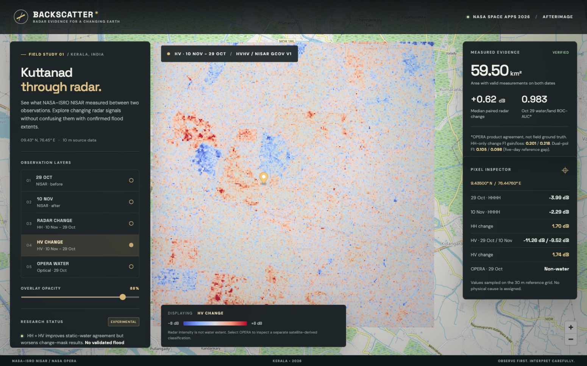
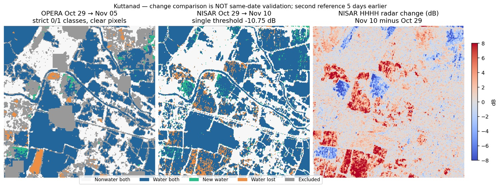
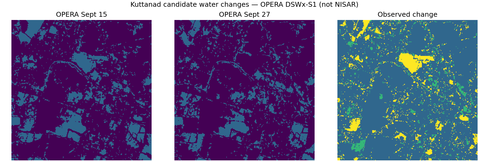

# Backscatter

## Dual-polarization study and evidence viewer — November 14, 2026

The web app now has an **HVHV cross-polarization change layer** and HH/HV pixel inspector, based on actual NISAR subsets for October 29 and November 10.

Adding HV improved held-out **existing open-water** agreement with OPERA (F1 **0.9435 → 0.9533**) but **worsened** gain/loss masks (F1 **0.2022/0.2185 → 0.1053/0.0981**). We preserve both the useful evidence and the failure cases. The validity mask marks every readable in-footprint pixel as valid; it did not remove false positives.



[Experiment details](research/kuttanad_validated_2026_10_11/DUAL_POLARIZATION.md) · [Experimental metrics](research/kuttanad_validated_2026_10_11/dualpol_quality_evaluation.json) · [Runnable app](web/README.md).


## Interactive evidence map — 14 November 2026

**The first working Backscatter web demo now exists.** Built in React + MapLibre, it displays real validated NISAR HHHH before/after imagery, a measured radar-difference overlay, and the independently classified OPERA October 29 water layer over Kuttanad. Click map cells to inspect actual before/after dB values and the OPERA class. Works on desktop and mobile.


Run locally (no token needed for the prepared curated dataset):

```bash
cd web
npm install
npm run dev
```

The website is an **evidence viewer, not a flood detector**. The current simple gain/loss classifier has poor OPERA agreement (F1 about 0.20/0.22), and the map deliberately does not display those experimental masks as confirmed flooding. [App instructions](web/README.md) · [Science and limitations](research/kuttanad_validated_2026_10_11/INDEPENDENT_COMPARISON.md).


## November 14: Independent water-reference experiment

**Current verified position: NISAR water/land discrimination works on this limited example; robust gain/loss detection does not.**

- Same-calendar-day Oct 29 NISAR HHHH versus clear OPERA DSWx-HLS (Sentinel-2B) open-water/non-water labels: **ROC-AUC 0.983** (descriptive, not ground truth).
- A single dB cutoff calibrated on the west half of Oct 29 (-10.75 dB) gave **F1 0.944** on east-half, spatially separated OPERA labels.
- On Nov 10 radar against **Nov 05 optical observations**, static-water F1 was **0.895**; the **five-day mismatch** limits inference.
- Using the same threshold to derive change masks, agreement with OPERA Oct 29 → Nov 05 was only **gain F1 0.201**, **loss F1 0.218**. **Do not call this accurate flood mapping.**
- Pixels that OPERA classifies as new open water show negative NISAR changes in **89.5%** of cases; open-water-loss pixels show positive NISAR changes in **89.6%**. These are conditional directional associations, not a reliable NISAR-only change mask.



[Scientific evaluation and failure analysis](research/kuttanad_validated_2026_10_11/INDEPENDENT_COMPARISON.md) · [Metrics JSON](research/kuttanad_validated_2026_10_11/change_baseline.json) · [Reproducible code](scripts/evaluate_change_baseline.py).

The MVP should show observed radar change **and** provenance/uncertainty, not claim every radar change represents flooding.


## Verified breakthrough — November 14, 2026

**Actual validated NISAR radar pixels have now been extracted for Kuttanad, Kerala.** NASA Harmony produced HHHH GeoTIFFs for **2026-10-29 and 2026-11-10**. Both rasters share an identical EPSG:32643 grid at **10 m resolution** (776 × 771 pixels).

Our first unclassified paired backscatter comparison covers **594,958** shared valid radar pixels (**59.4958 km²**), with a **+0.6231 dB median pixel-wise change**. These numbers show measured radar response, **not** water extent or flood detection.


[Verified research report](research/kuttanad_validated_2026_10_11/README.md) · [Scientific metrics](research/kuttanad_validated_2026_10_11/nisar_pair_summary.json) · [Reproducible Harmony retrieval](scripts/harmony_validated_kuttanad.py) · [Comparison script](scripts/analyze_harmony_kuttanad.py).


**Team Afterimage · NASA Space Apps Challenge 2026 · Dancing with the SARs**

> **See the evidence of Earth's changing waters.**

Backscatter is a proposed interactive, evidence-driven application for investigating changes in floodplain and wetland water coverage using repeat **NASA–ISRO NISAR SAR measurements**. Planned outcome: change maps, measurements, uncertainty, and explanation grounded in observable radar evidence.

**Current phase: verified scene inventory and an initial NISAR extraction implementation. No NISAR-derived inundation mask, validation score, live dashboard, or working flood predictor exists yet.**

## November 14, 2026 — validated GCOV study pair (current priority)

The November 6 validated NISAR release includes Kuttanad observations **2026-10-29** and **2026-11-10**, matching track/frame `077_D_084_4005_DHDH` and processor `P05036`. These replace the *September provisional pair as our primary candidate*; the earlier OPERA-only September analysis remains useful preliminary research, not a NISAR validation result.

- **Verified today:** NASA CMR collection `C3622241360-ASF` returns both exact granules; the Mac preflight and synthetic numerical tests passed.
- **Not yet verified:** authenticated retrieval of actual radar arrays from the *new* validated files; aligned HHHH measurements; water classification; accuracy.
- **New tool:** `scripts/extract_validated_kuttanad.py` discovers the granules, prompts locally for an Earthdata token, reads only an AOI, produces aligned 30 m HHHH backscatter GeoTIFFs plus an **unclassified** dB-difference raster and JSON. Its remote GDAL read remains untested until run with credentials.
- **Follow-up validation candidates:** OPERA DSWx-HLS optical products including 2026-10-29; OPERA DSWx-S1 2026-10-21/11-02. These are **not date-matched reference pairs** for 10/29 and 11/10.

See [validated data execution](docs/VALIDATED_DATA_EXECUTION.md) and [new scene manifest](research/kuttanad_validated_2026_10_11/scene_manifest.json).

## Earlier research — 2026-11-03

- **Kuttanad, Kerala** is the primary candidate, with a small study box at `[76.42, 9.40, 76.49, 9.47]` (longitude/latitude, WGS84).
- Two repeat NISAR **L2 provisional GCOV** products were located (2026-09-14 and 2026-09-26); a local Mac test received HTTP **206** and valid HDF5 file signatures for both.
- Two **OPERA DSWx-S1** surface-water products (2026-09-15 and 2026-09-27) were downloaded, inspected, and compared on their common 30 m grid. These are **independent Sentinel-1 observations**, not NISAR results or definitive ground truth.
- Across **59.9067 km²** of valid compared pixels: **3.0483 km² new water/inundated-vegetation classification**, **5.1462 km² loss**, **8.4474 km² classified water on both dates**; net classified-water change **-2.0979 km²**.
- **Still unverified:** extracting actual NISAR measurement arrays; their scientifically meaningful change; agreement with reference observations; classification accuracy.



See [research record](research/kuttanad_2026_09/README.md), [project status](docs/PROJECT_STATUS.md), and [data manifest](research/kuttanad_2026_09/scene_manifest.json).

## Reproduce the preparatory data checks

```bash
python3 -m venv .venv
source .venv/bin/activate
pip install -r requirements-research.txt
python scripts/verify_earthdata_access.py
python scripts/compare_opera_dswx.py
```

A free NASA Earthdata account/token is required; scripts request a token interactively and **never store it**. Downloaded source TIFFs are placed outside the repository in `~/Downloads/backscatter-opera-check/`. Full instructions: [docs/REPRODUCTION.md](docs/REPRODUCTION.md).

## Intended MVP (not yet built)

1. Select a compatible NISAR radar pair.
2. Extract and quality-check matching radar measurements; calculate change features.
3. Classify probable water-extent change with explicit uncertainty.
4. Compare with independent observations and report documented limitations.
5. Show evidence and provenance through an interactive map.

Avoid representing OPERA-derived changes as NISAR detections, or seasonal water changes as confirmed flood damage. No disaster prediction, landslide detection, or unverified AI claims in the MVP.

**Repository index:** [Master context](CONTEXT.md) · [Architecture](docs/ARCHITECTURE.md) · [Scientific plan](docs/DATA_AND_PIPELINE.md) · [Validation](docs/VALIDATION_PLAN.md) · [Hackathon plan](docs/HACKATHON_EXECUTION.md) · [Research status](docs/PROJECT_STATUS.md).

**Security:** Do not commit Earthdata access tokens, `.netrc`, credentials, signed links, or raw multi-GB satellite downloads. Check NASA Space Apps pre-event development rules before using this research preparation as part of a final submission.
