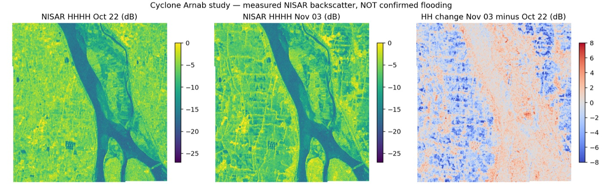

# Cyclone Arnab — measured event-linked NISAR test

**Backscatter / Team Afterimage · November 14, 2026**

**Result:** We successfully compared two real validated NASA–ISRO NISAR L-band radar scenes spanning the October 28 Cyclone Arnab landfall with independent NASA OPERA Sentinel-1D water-classification products acquired about **11.2 hours after each NISAR date**. A conservative, unchanged radar-change rule failed to identify the OPERA-classified open-water transitions. This is a reproducible negative result, **not evidence that no flooding occurred**.

## Official event and predefined area

India Meteorological Department confirmed that Very Severe Cyclonic Storm Arnab crossed the Andhra Pradesh and Yanam coasts on October 28, 2026, near **16.45°N, 81.9°E**. The International Charter activated for flooding in Andhra Pradesh and Odisha. Our AOI was selected before opening the radar imagery: **81.82–81.89°E, 16.58–16.65°N** in the Godavari delta, north of the reported landfall position.

This AOI is linked geographically and temporally to the documented cyclone. We do **not** claim that the cyclone caused every satellite-observed class transition within this box.

## Four actual source rasters

| Source | Before event | After event |
|---|---|---|
| Validated NISAR GCOV HHHH, L-band, 10 m | October 22, 13:09:52 UTC | November 3, 13:09:53 UTC |
| OPERA DSWx-S1 WTR, Sentinel-1D C-band, 30 m | October 23, 00:22:03 UTC | November 4, 00:22:02 UTC |
| OPERA − NISAR observation gap | **11.2031 hours** | **11.2025 hours** |

NISAR uses matching track/frame/mode **149_D_080_4005_DHDH**, processing release **P05036**. OPERA source granules are tile **T44QND**, not the neighboring T44QPD tile.

### Important data-coverage correction

NASA CMR returned **both T44QPD and T44QND** on these dates for the broad AOI catalog query. Our first downloader selected T44QPD, but Rasterio revealed that its actual 30 m georeferenced bounds began at UTM easting 600,000 m, **outside the NISAR subset** (roughly 587,450–594,940 m). No strict reference pixels were shared, so the initial experiment correctly rejected the pair without a score.

We corrected **only the reference tile to T44QND**, based on geographic data overlap—not on its water classifications or agreement metrics—and kept the originally selected AOI and both NISAR dates. T44QND covers UTM easting 499,980–609,780 m and genuinely overlaps the NISAR subset. Both source dates and reference classes were then loaded and compared.

The four raw source TIFFs remain outside the repository. Their non-sensitive SHA-256 hashes are in [source_checksums.json](source_checksums.json), and exact granule IDs appear in [scene_manifest.json](scene_manifest.json).

## Methods

1. Read actual positive calibrated NISAR HHHH power in both 10 m GeoTIFFs.
2. Average **linear** power onto the native aligned OPERA **30 m** grid before converting to dB.
3. Compare only OPERA classes **0 = non-water** and **1 = open water** for strict binary diagnostics, while retaining and reporting **3 = inundated vegetation** separately.
4. Apply the same *predefined, label-free radar-signal rules* used for Kuttanad and Assam: RAW (HH change at least ±3 dB), MEDIAN3 (per-date 3×3 median, then ±3 dB), and COHERENT (MEDIAN3 with at least 6/9 neighbors supporting the same strong direction). OPERA is used only **afterward** for comparison.
5. Separately test a **locally fitted water threshold** trained against first-date OPERA classes in the western half of this AOI and evaluated on the eastern half. This is a static-water diagnostic, *not* the main independently transferred change method.

## Actual measured results

| Measurement | Value |
|---|---:|
| Shared valid 30 m NISAR cells | **64,495** |
| Shared valid NISAR area | **58.0455 km²** |
| Strict OPERA class-0/1 cells, both dates | **58,085** |
| NISAR median HH change | **−0.0992 dB** |
| OPERA 0 → 1 newly classified open-water cells | **842** |
| OPERA 1 → 0 lost open-water cells | **75** |
| OPERA newly classified open-water area, strict shared cells | **0.7578 km²** |

**The 0.7578 km² figure is the OPERA product's strict 0→1 reference-class area, not an independent estimate of cyclone flooding or damage.**

### Unchanged, label-free radar signal rules

| Diagnostic | RAW ±3 dB | MEDIAN3 | COHERENT |
|---|---:|---:|---:|
| Strong radar-signal change area (km²) | 11.0628 | 7.1703 | **4.4163** |
| OPERA new-open-water vs HH-decrease F1 | 0.0035 | 0.0012 | **0.0000** |
| OPERA lost-open-water vs HH-increase F1 | 0.0000 | 0.0000 | **0.0000** |
| OPERA-stable non-water flagged, either direction | 22.545% | 15.230% | **9.528%** |

Spatial filtering reduced signal-highlighted clutter, but the **unchanged COHERENT method identified none of the 842 OPERA 0→1 or 75 OPERA 1→0 transitions** in the strictly shared reference cells. Its **4.4163 km² is radar-signal change, not flooded land**.

### Supervised static-water diagnostic (separate from the fixed change experiment)

Using OPERA class 0/1 labels from the first date to select a **−14.5 dB** cutoff on the western half:

- First-date eastern-half static open-water F1: **0.8987**, precision 0.8364, recall 0.9710.
- Second-date static open-water F1 against OPERA: **0.8549**.
- Reference gain F1 from threshold transitions: **0.1347**; reference loss F1 **0.0122**.
- Unmodified Kerala-trained **−10.75 dB** cutoff applied to this AOI yields gain F1 **0.0049** and loss F1 **0.0000**.

These illustrate why an apparently successful *static* water classifier does not automatically become a successful *change* detector. The locally fitted score must not be reported as independent generalization from Kerala.

## What we can conclude

Cyclone Arnab is a **documented external event**, and the pre/post acquisitions are comparatively well aligned. There are real changes in OPERA classification across the AOI, including open water and inundated vegetation. But our fixed radar darkness/coherence method **does not reliably identify those water-class transitions**.

Likely confounds include river-channel geometry, agricultural fields, vegetated water, soil moisture, landscape-dependent radar scattering, different L-band and C-band responses, and the remaining 11.2-hour sensor separation. These are hypotheses, not proven causes for any particular pixel.

ASF also documents possible radiometric residuals around 1 dB in certain NISAR acquisition modes prior to November 12, 2026; the affected status of these granules has **not** been established. Therefore the −0.0992 dB scene median cannot be confidently assigned to a geophysical event.

**Conclusion for Backscatter:** Keep the three-case scientific evidence and negative results, and present the live two-study NISAR explorer as an honest investigation tool—not as a validated flood detection, flood prediction, warning, or damage-mapping system.

## Reproduction

The approved local Earthdata token was used only in memory to fetch data. On the authorized Mac:

\`\`\`bash
python3 scripts/preflight_arnab.py
python3 scripts/harmony_arnab.py fetch
python3 scripts/fetch_opera_arnab.py
~/Downloads/backscatter-venv/bin/python3 scripts/compare_arnab_opera.py
\`\`\`

The result JSON at [arnab_nisar_opera_diagnostic.json](arnab_nisar_opera_diagnostic.json) contains the original confusion counts, source names, radar-class medians, and tested methods. No raw satellite file or Earthdata token is committed.

**Sources:** [India Meteorological Department](https://mausam.imd.gov.in/Forecast/mcmarq/mcmarq_data/Press%20Release%20Dtd%2028.10.2026.pdf) · [International Charter activation 1056](https://disasterscharter.org/activations/flood-in-india-activation-1056-) · [NASA ASF NISAR documentation](https://nisar-docs.asf.alaska.edu/availability-overview/) · [NASA OPERA DSWx](https://www.jpl.nasa.gov/go/opera/products/dswx-product-suite/) · [ASF known issues](https://hyp3-docs.asf.alaska.edu/nisar-docs/release-notes/).
