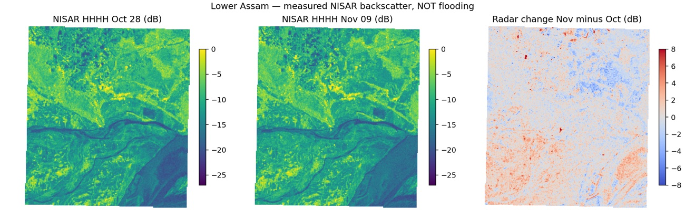

# Lower Assam — measured NISAR and OPERA comparison

**Research status: processed real satellite pixels, 14 November 2026.**

**Scope:** Second independent geographic case for Backscatter, Team Afterimage. This experiment tests product-to-product agreement, **not** field-confirmed flood detection.

## Question

Does a simple L-band NISAR HHHH open-water threshold learned in Kuttanad generalize to a very different riverine and agricultural landscape in Lower Assam? Can the same method reliably identify **water gaining or disappearing**?

The answer from this limited pair is **no**. A separately fitted Assam threshold also gives poor change-mask agreement. The application therefore displays actual satellite evidence and clear uncertainty, not a purported flood map.

## Inputs actually downloaded and measured

| Data | First acquisition | Second acquisition |
|---|---|---|
| NASA–ISRO validated NISAR GCOV V1 HHHH | 28 Oct 2026 | 09 Nov 2026 |
| NASA OPERA DSWx-S1 v1.0 WTR, Sentinel-1 C-band | 31 Oct 2026 | 10 Nov 2026 |
| Calendar-day offset, OPERA minus NISAR | +3 days | +1 day |

- **Study area:** WGS84 bbox lon 90.28–90.35, lat 26.16–26.23; Lower Assam, India.
- **NISAR:** both 10 m EPSG:32646 GeoTIFFs have 789 × 715 pixels, identical georeferencing, and 543,117 valid positive pixels at both dates. The acquisition configuration matches \`069_A_015_4005_DHDH\` (P05036).
- **OPERA S1:** two 30 m WTR GeoTIFFs; crop/window 263 × 238 cells, with 0 non-water, 1 open water, 3 inundated vegetation, 251 layover/shadow mask. Do **not** apply OPERA **HLS** class-2 partial-water semantics to S1 class 3.
- **Data status:** NISAR Harmony downloads and authenticated OPERA TIFF downloads succeeded. Exact product IDs and collection IDs: [catalog manifest](scene_manifest.json). SHA-256 checksums of all four local original TIFFs: [source manifest](source_checksums.json).
- **Security:** Source TIFFs are local on the authorized Mac. No bearer token, credential file or signed download URL is committed.

## Method

1. Read genuine positive finite calibrated NISAR GCOV HHHH power on both dates.
2. Average **linear power** to OPERA's 30 m georeferenced grid, then calculate \`10 log10(power)\`. This avoids treating upscaled 10 m pixels as independent OPERA labels.
3. Keep only the common radar-valid pixels for paired change. For strict open-water metrics compare OPERA WTR **0 vs 1**, excluding WTR 3 inundated vegetation and all masked cells. Class 3 is still shown and analyzed as distinct physical context.
4. On the first Assam scene, fit a single darkness threshold using OPERA reference labels **in the western half only**, test on the eastern half. The result is a diagnostic spatial split, not full out-of-sample validation.
5. Transfer that fitted Assam threshold without retuning to the second NISAR date and compare open-water gain/loss with OPERA classifications. Note that the OPERA products are **3 and 1 days later** than NISAR.
6. **Independent transfer test:** apply the **unchanged −10.75 dB cutoff learned in Kuttanad** to both Assam NISAR scenes and recompute agreement with the Assam OPERA S1 reference. This is a more genuine threshold-generalization test.

## Measured radar statistics

| Metric | Result |
|---|---:|
| Both-date common radar-valid 30 m cells | **60,640** |
| Common radar-valid area | **54.576 km²** |
| Both-date strict reference 0/1 cells | **50,500** |
| Paired median HHHH change, 9 Nov minus 28 Oct | **+0.1012 dB** |

These values describe radar **signal**, not water-gain acreage or confirmed flooding.

### Water/land backscatter differs by class

| OPERA S1 class | Median NISAR HHHH, first date* | Second date* |
|---|---:|---:|
| 0 — non-water | −9.7867 dB | −9.9612 dB |
| 1 — open water | −17.9358 dB | −17.0660 dB |
| 3 — inundated vegetation | −12.1886 dB | −11.7553 dB |

*The first OPERA reference was captured 3 days after its NISAR scene; the second 1 day after. Class groupings are *reference classifications*, not direct ground-truth observations. Inundated vegetation can produce different radar scattering than open, unobstructed water.

## Two baseline experiments

| Measurement | New threshold fitted in Assam | Kuttanad's fixed −10.75 dB cutoff applied in Assam |
|---|---:|---:|
| Threshold | **−17.75 dB** | **−10.75 dB (unchanged)** |
| First-scene static open-water F1 | **0.6755** (held-out east half) | **0.4275** (all strict cells, no refit) |
| Static precision (same respective evaluation subsets) | 0.9081 | 0.2719 |
| Static recall (same respective evaluation subsets) | 0.5377 | 0.9986 |
| Candidate new-water F1 against OPERA transitions | **0.0353** | **0.0000** |
| Candidate lost-water F1 against OPERA transitions | **0.0336** | **0.0000** |

**Important:** The first-row F1 evaluations have different test subsets (Assam east-half vs all Assam strict cells). They are **diagnostic**, not an apples-to-apples controlled model benchmark. For the fixed-cutoff full first reference, precision is just 0.2719 because it marks a large amount of non-water as water.

The separately fitted Assam gain/loss confusion counts are:

- **Gain:** TP 18, FP 809, FN 174, TN 49,499; precision **0.0218**, recall **0.0938**, F1 **0.0353**.
- **Loss:** TP 44, FP 2,253, FN 275, TN 47,928; precision **0.0192**, recall **0.1379**, F1 **0.0336**.

The *unchanged Kerala cutoff* found **zero true positives** for the 192 OPERA 0→1 gains and 319 OPERA 1→0 losses, despite predicting thousands of candidate changes. This confirms the simple calibrated cutoff cannot be reused uncritically across these two geographic examples.

### Changes in classified water do not align convincingly with simple radar directions

In strict OPERA class transitions, conditioned on a reference-classified change:

- **0→1 (new open water):** 192 cells; median NISAR delta **−0.0687 dB**, with only **51.56%** of radar deltas negative.
- **1→0 (lost open water):** 319 cells; median delta **−0.0209 dB**, with **49.22%** of radar deltas positive.
- **0→3 (newly classified inundated vegetation):** 3,101 cells; median NISAR delta **+0.4329 dB**.
- **3→0:** 2,714 cells; median NISAR delta **+0.3268 dB**.

These observations are not a clear directional water-change detector. In particular, flooded vegetation can produce a higher return, and reference dates are not simultaneous.

## Scientific interpretation

The original Kuttanad HH-only reference agreement (held-out F1 ≈0.944) and the newly fitted Assam result (held-out F1 ≈0.676) use **different OPERA products**: DSWx-HLS optical vs DSWx-S1 C-band radar. Different class definitions, date offsets, landscapes, radar incidence/vegetation, and sampling prevent interpreting that F1 difference as a pure geographic model degradation. Nevertheless, the **unchanged Kerala cutoff itself performs poorly against the Assam reference**, and change masks fail in both cases. This directly weakens any claim of a universal simple threshold.

Additional caveats:

- **No field ground truth.** OPERA S1 is an algorithmic satellite classification and has its own false positives/negatives; it is independent of NISAR but not independent ground truth.
- **Temporal mismatch** (+3 / +1 days) may represent real intervening water or field changes.
- **Pre-November-12 calibration issue:** [NASA ASF release notes](https://hyp3-docs.asf.alaska.edu/nisar-docs/release-notes/) describe approximately 1 dB residuals in some pre-November-12 radar modes. We have not determined whether the selected granules belong to the affected RCIDs. The small +0.1012 dB paired median is therefore not demonstrated as a true geophysical change.
- The OPERA 30 m pixels are spatially autocorrelated, and single-scene west/east splitting is not fully independent validation.
- No flood event attribution, population impact, damage estimate, predictive accuracy, or physical water-extent estimate is made.

## Implication for Backscatter

**Retain a transparent dual-study NISAR evidence viewer.** Show both regions and original OPERA water-reference class layers, preserve acquisition dates, use only measured radar signal for change overlays, and disclose the lack of reliable change-mask accuracy.

The next scientific improvement is not another arbitrary global threshold. It is a carefully defined water-change task with genuinely date-aligned reference data, vegetation-aware features and independent event/scene validation.

## Reproduce

On a trusted Earthdata-authenticated Mac:

\`\`\`bash
python scripts/preflight_assam.py
python scripts/harmony_assam.py fetch        # use existing submitted jobs
python scripts/fetch_opera_assam.py
python scripts/compare_assam_opera.py
python scripts/export_assam_demo.py
\`\`\`

Outputs: \`~/Downloads/backscatter-assam-validated/analysis/\` (JSON metrics and radar comparison) and \`web/public/data/assam/\` (curated visualization assets). The NISAR/OPERA TIFFs stay out of Git.

[Exact computed JSON](assam_nisar_opera_diagnostic.json) · [Source SHA-256 checksums](source_checksums.json) · [Official OPERA S1 water classes](https://d2pn8kiwq2w21t.cloudfront.net/documents/OPERA_DSWx-S1_Product_Spec_v1.0.0_D-108761_RevA_2024-08-16_.pdf) · [NASA NISAR validated data known issues](https://hyp3-docs.asf.alaska.edu/nisar-docs/release-notes/).
