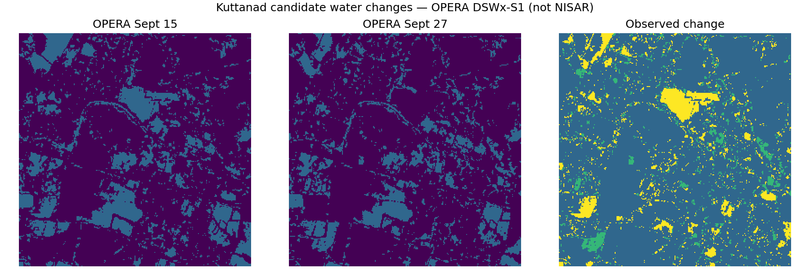

# Kuttanad (Kerala): research feasibility record

**Recorded:** 2026-11-03 | **Status:** preliminary remote-sensing data feasibility, **not** a validated flood map.

## Research question

Do repeat NASA–ISRO NISAR L-band radar observations provide evidence of an interpretable change in surface-water or inundated vegetation around Kuttanad, and can that interpretation be independently checked?

## Study extent

Approximate WGS84 bounding box (longitude/latitude): `76.42, 9.40, 76.49, 9.47`.

## Exact source products

| Sensor/product | Acquisition | Product ID |
|---|---|---|
| NISAR L2 GCOV (provisional) | 2026-09-14 | `NISAR_L2_PR_GCOV_030_113_A_006_4005_DHDH_A_20260914T003206_20260914T003233_P05023_N_F_J_001` |
| NISAR L2 GCOV (provisional) | 2026-09-26 | `NISAR_L2_PR_GCOV_031_113_A_006_4005_DHDH_A_20260926T003206_20260926T003233_P05023_N_F_J_001` |
| OPERA DSWx-S1 | 2026-09-15 | `OPERA_L3_DSWx-S1_T43PFL_20260915T004012Z_20261012T040218Z_S1D_30_v1.0` |
| OPERA DSWx-S1 | 2026-09-27 | `OPERA_L3_DSWx-S1_T43PFL_20260927T004012Z_20261012T121535Z_S1D_30_v1.0` |

NISAR granules share an acquisition geometry identifier `113_A_006_4005_DHDH`. User-run, bearer-token-authenticated HTTP requests received **206 Partial Content**, recognized HDF5 magic headers, and a returned source size of **3,959,422,976 bytes** each. OPERA water-band TIFFs were downloaded with valid headers: **285,247** and **296,005** bytes.

These checks establish file accessibility only, not the extraction or analysis of NISAR radar-value arrays.

## OPERA-only observation, Sep 15 → Sep 27

Raster tile `T43PFL`, projected EPSG:32643, nominal 30 m resolution, 900 m²/cell. Mask restricted to pixels of valid class `0`, `1`, or `3` on **both dates**. Binary 'water or inundated vegetation' = OPERA class `1` (open water) or `3` (inundated vegetation).

| Outcome | Cells | km² |
|---|---:|---:|
| Valid on both dates | 66,563 | 59.9067 |
| Non-water → water/inundated vegetation | 3,387 | 3.0483 |
| Water/inundated vegetation → non-water | 5,718 | 5.1462 |
| Water/inundated vegetation both dates | 9,386 | 8.4474 |
| Non-water both dates | 48,072 | 43.2648 |
| 15 Sep classified water area | 15,104 | 13.5936 |
| 27 Sep classified water area | 12,773 | 11.4957 |

Net loss: **2.0979 km²** in the studied valid comparison region (**15.4% decrease** versus Sep 15).

Analysis data: [opera_comparison.json](opera_comparison.json). Reproduction script: [scripts/compare_opera_dswx.py](../../scripts/compare_opera_dswx.py).

### What the map can and cannot support

The figure is from **OPERA Sentinel-1 water-product classifications**, not radar-derived Backscatter outputs. The local date pair has plausible candidate water-extent changes. It does **not** establish a flood, flood severity, property damage, flooding cause, NISAR classification accuracy, or that changes in class 3 have the same confidence as open water.

The observation dates are **Sep 15/27** for OPERA and **Sep 14/26** for NISAR. It is incorrect to report an exact same-day independent validation until temporal mismatch is handled explicitly.

### Known weaknesses

- Differences in atmospheric/rainfall conditions, agricultural water management, vegetation and classification can influence observed changes.
- OPERA itself is a model-derived classification, **not ground truth**.
- The raster comparison is pixel-wise on a common source grid, not independently verified with field measurements.
- We have not tested NISAR extraction, pixel-level differences, calibration, noise, time series stability or any validated threshold.

## Source discovery

- NASA CMR: https://cmr.earthdata.nasa.gov/search/granules.json
- NISAR L-band GCOV collection: `C2854338529-ASF`
- OPERA DSWx-S1 collection: `C2949811996-POCLOUD`
- NISAR GCOV documentation: https://nisar-docs.asf.alaska.edu/gcov/
- OPERA product documentation: https://www.jpl.nasa.gov/go/opera/products/dswx-product-suite/
- NASA NISAR data: https://science.nasa.gov/mission/nisar/data/

## Next experiment

Extract small colocated NISAR GCOV measurement layers from Sep 14 and 26, calculate backscatter differences, inspect artifacts, then compare candidate water-change regions against OPERA water products. If the match is poor, test a different date pair or switch to a better-covered Assam study area.

See [project status](../../docs/PROJECT_STATUS.md).
