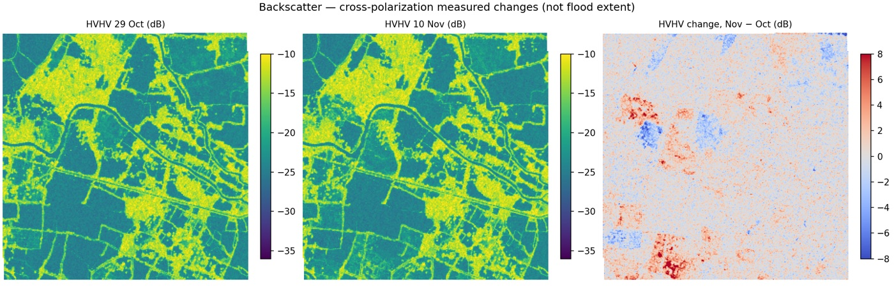

# Dual-polarization and NISAR quality-layer experiment

**Backscatter / Afterimage · November 14, 2026 · Kuttanad, Kerala**

## Result in one paragraph

The extra NASA–ISRO NISAR GCOV **HVHV** channel slightly improved separation of *existing* OPERA-classified open water from non-water (east-half holdout F1 **0.9435 → 0.9533**), but a simple model using HH and HV together was **worse at predicting gains/losses in water classification** (gain F1 **0.2022 → 0.1053**, loss F1 **0.2185 → 0.0981**). Quality masking removed no additional in-footprint pixels in this case. This supports an honest **radar-evidence map with both polarization channels**, not a flood-change accuracy claim.

## Real inputs and provenance

The same validated NISAR frequency-A GCOV scenes and study AOI used in our [main study](README.md):

- **Oct 29:** \`NISAR_L2_PR_GCOV_034_077_D_084_4005_DHDH_A_20261029T132026_20261029T132100_P05036_N_F_J_001\`
- **Nov 10:** \`NISAR_L2_PR_GCOV_035_077_D_084_4005_DHDH_A_20261110T132027_20261110T132100_P05036_N_F_J_001\`
- **NASA Harmony collection:** \`C3622241360-ASF\` (\`NISAR_L2_GCOV_V1\`); actual frequency-A variable IDs: \`HVHV=V4137651725-ASF\`, \`mask=V4137651736-ASF\`, \`numberOfLooks=V4137651748-ASF\`.
- **Reference labels:** OPERA DSWx-HLS v1.1 class 0 non-water / class 1 open water. Oct 29 Sentinel-2B optical is same-calendar-day; Nov 05 Sentinel-2A optical predates Nov 10 radar by **five days**.

Each ancillary layer was independently subset through Harmony to approximately 776 × 771 cells at 10 m in EPSG:32643. Six successful processing jobs yielded **two HVHV, two mask and two numberOfLooks GeoTIFFs**. Source TIFFs and private Earthdata credentials remain **outside** Git.

[See source report](dualpol_quality_evaluation.json), [Harmony downloader](../../scripts/harmony_extra_layers.py), [evaluation implementation](../../scripts/evaluate_dualpol_quality.py).

## Quality layers checked

| Observation | Value |
|---|---:|
| Shared valid in-footprint 10 m pixels in each date | 594,958 |
| NISAR mask over those positive-backscatter pixels | 1 (valid subswath) |
| Additional invalid (0) mask values within returned valid area | 0 |
| Outside-footprint / nodata pixels in each subset | 3,338 |
| Median number of looks | 4.502 per date |
| Number-of-looks 1st–99th percentiles | 3.701–5.354 |

Valid subswath identifiers are 1–254; mask 0 is invalid and 255 is fill/out-of-coverage. In the downloaded subset, masked nodata is excluded by Rasterio; all other pixels read as mask=1. **Consequently the mask does not explain false positives in these two scenes.**

The rule \`numberOfLooks >= 4\` was evaluated as an exploratory sensitivity filter, **not a mission-established confidence threshold**. It left 43,448 strict reference-comparable 30 m cells but did not rescue the change F1.

## Evaluation protocol

1. For both dates, require positive finite HH and HV power and a valid GCOV mask.
2. Average radar **linear gamma0 power** from 10 m to the common OPERA **30 m** grid, then transform to dB via \`10 log10(power)\`. Do not upscale OPERA labels to a larger pseudo-sample count.
3. Keep only cells with valid radar coverage fraction ≥0.99 on both dates for comparable evaluation. Exclude OPERA class 2 partial water from strict binary evaluation; exclude masked classes 252/253/254/255.
4. Choose a water score \`(1−w) HH_dB + w HV_dB\` with candidate weights {0, 0.25, 0.5, 0.75, 1}. Fit the score cutoff to maximize open-water F1 on **Oct 29 western-half cells only**. Do not use water-change reference labels in fitting.
5. Evaluate on the **eastern half** (spatial holdout) of Oct 29. Transfer the cutoff without retraining to Nov 10 radar, with Nov 05 OPERA optical reference for context.
6. Evaluate binary gain and loss by applying the fixed score to each radar date. Also test a **non-tuned** directional gate requiring both HH and HV to change by at least 2 dB in the physically plausible direction.

## Results: same evaluation mask, fair ablation

| Metric | HH-only model | Weighted HH+HV model |
|---|---:|---:|
| Weight given to HV | 0 | 0.75 |
| Trained score threshold | −10.75 dB | −16.00 dB |
| Oct 29 east-half open-water AUC | 0.97895 | **0.98644** |
| Oct 29 east-half static-water F1 | 0.9435 | **0.9533** |
| Nov 10 radar / Nov 05 optical static-water F1 | 0.8950 | **0.9147** |
| Candidate gain precision | **0.2097** | 0.1487 |
| Candidate gain recall | **0.1952** | 0.0815 |
| Candidate gain F1 | **0.2022** | 0.1053 |
| Candidate loss precision | **0.1671** | 0.1321 |
| Candidate loss recall | **0.3157** | 0.0780 |
| Candidate loss F1 | **0.2185** | 0.0981 |

Common radar-quality cells: **65,856** on OPERA's 30 m grid. Strict reference-valid cells on both optical dates: **44,862**. No region outside Kuttanad or further independent event was tested.

The fixed sign gate raised *gain precision* to **0.2690**, but dropped gain recall to **0.0548** and F1 to **0.0910**. It is therefore **not an improvement in overall change detection**. Filtering by arbitrary looks threshold similarly failed to improve change agreement.

## Interpretation and limits

- Cross polarization is useful for additional observations and possible static-water discrimination.
- The gain/loss objective is fundamentally harder; temporal differences, flooded crops, vegetated water, shoreline mixtures and changing roughness can cause false positives.
- A high same-day AUC/F1 describes agreement with the **satellite-derived OPERA WTR label product**. It is **not measured flood-extent accuracy** and does not validate change masks.
- The final optical reference is **five days earlier** than the second radar acquisition. Some apparent disagreements may be real intervening surface changes.
- The western/eastern split reduces direct train/test overlap, but spatially correlated fields remain; multiple scenes and geography are needed to generalize.
- The model and cutoff are simple exploratory baselines; weight selection is supervised on OPERA and not an independent validation.
- No new flooding, damage or cause is established by this experiment.

**Decision:** Use **HHHH difference** as the primary evidence layer; add a separate **HVHV difference** layer and dual-channel pixel inspection. Keep water-gain and water-loss classification explicitly experimental until a stronger, date-aligned test exists.

## Source documentation

- [NASA/ASF GCOV User Guide](https://nisar-docs.asf.alaska.edu/gcov/) — explains diagonal covariance backscatter, mask and number of looks.
- [NASA NISAR Cookbook](https://asfopensarlab.github.io/NISAR_Cookbook/nisar-data-access/) — describes subswath mask values and ancillary arrays.
- [OPERA DSWx-HLS Product Specification](https://d2pn8kiwq2w21t.cloudfront.net/documents/OPERA_DSWx-HLS_ProductSpec_v1.0.0_D-107395_RevB.pdf).

**Reproduce on a trusted environment (Earthdata token at hidden prompt):**

\`\`\`bash
python scripts/harmony_extra_layers.py submit
# Once Harmony jobs complete:
python scripts/harmony_extra_layers.py fetch
python scripts/evaluate_dualpol_quality.py
python scripts/export_demo_assets.py
\`\`\`
