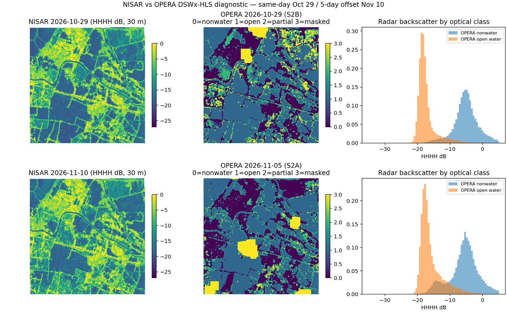
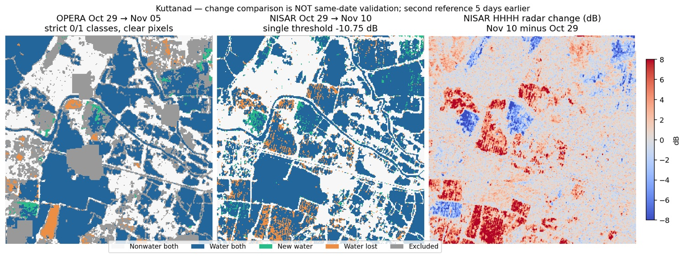

# Kuttanad NISAR–OPERA experiment: what works and what does not

**Executed November 14, 2026 · Team Afterimage · Backscatter**

## Question and design

Can NISAR validated L-band HHHH radar observations distinguish water from non-water, and do the *changes* correspond to independent OPERA optical water classifications?

Region: Kuttanad, Kerala; WGS84 AOI [76.42, 9.40, 76.49, 9.47].

- **Primary radar**: NISAR validated L2 GCOV V1, 2026-10-29 and 2026-11-10; see [exact source granules](scene_manifest.json).
- **Independent reference product**: NASA OPERA DSWx-HLS v1.1 WTR (Sentinel-2) 2026-10-29 and 2026-11-05, `C2617126679-POCLOUD`; not field ground truth.
- **Temporal mismatch**: Oct 29 acquisitions occur on the same calendar date, not simultaneously. Nov 05 optical is **five days before** Nov 10 radar.
- **Resolution method**: average NISAR *linear* backscatter power from the real 10 m GeoTIFFs onto native OPERA 30 m grid; only then convert positive power to decibels with `10log10`.
- **Reference classes**: 0 non-water, 1 open water, 2 partial water; exclude 2 from strict binary ROC-AUC/F1, and exclude 252/253/254/255 invalid/masked. Never mistake invalid scenes for dry scenes.

## Quality screening

Six real OPERA WTR TIFFs were downloaded and checksum-recorded. October 29 Sentinel-2B had **90.07%** valid classification coverage, Nov 05 Sentinel-2A **92.88%**. Oct 29 Sentinel-2A and Nov 01 Sentinel-2B were **entirely invalid over the AOI** and excluded. See [quality report](opera_reference_quality.json), [granule manifest](opera_hls_manifest.json).

## 1. Radar separates existing open water from dry land

| Metric | Value |
|---|---:|
| Oct 29 open-water median NISAR HHHH | −18.0946 dB |
| Oct 29 non-water median NISAR HHHH | −5.0692 dB |
| Oct 29 strict 0/1 discrimination ROC-AUC | **0.98306** |
| Nov 10 NISAR vs Nov 05 OPERA ROC-AUC | **0.94726** |
| Threshold fitted on Oct 29 west half | **−10.75 dB** |
| Oct 29 east-half spatial holdout static-water precision | 0.9432 |
| East-half static-water recall | 0.9439 |
| East-half static-water F1 | **0.9435** |
| Nov 10 radar vs Nov 05 optical static-water F1 | 0.8953 (5-day offset) |

The threshold is trained against OPERA's own classifications, so the held-out number is **internal satellite-product agreement**, not a ground truth performance claim. East/west holdout reduces direct memorization but leaves landscape-level and spatial dependencies.



## 2. Water *change* detection fails a single-threshold baseline

Predicted water at each date: mean HHHH power in OPERA 30 m cell maps to `10log10(power) <= −10.75 dB`. Candidate gain = non-water → water, loss = water → non-water. Compare against strict OPERA classes 0/1 on Oct 29 → Nov 05, valid on both dates (the second source is 5 days earlier than second NISAR).

| Change class | Precision | Recall | F1 | IoU |
|---|---:|---:|---:|---:|
| Gain | **0.2087** | 0.1944 | **0.2013** | 0.1119 |
| Loss | **0.1669** | 0.3143 | **0.2181** | 0.1224 |

**Conclusion:** strong existing water/non-water separation **does not transfer to reliable water-gain/loss masks**. Thresholding alone generates too many false positives in changing field conditions.



## 3. Radar-change directions still contain useful physical evidence

Among reference cells with strict 0→1 OPERA open-water transitions (**715 cells**, Oct 29→Nov 05), the NISAR HHHH change (Oct 29→Nov 10) is median **−3.1647 dB**; **89.51%** of those cells decrease.

Among reference cells with strict 1→0 transitions (**1,314 cells**), the NISAR HHHH change is median **+4.3778 dB**; **89.65%** increase.

Those percentages are **conditional on reference-classified transitions**. They do not measure a radar change map's precision, and date mismatch/crop management are substantial confounds. Aggregating partial-water class 2 reduces the clarity of the observed directional relationship.

## What this means for the product

The initial validated product should emphasize:
1. Measured NISAR before/after radar observations and dB-change map.
2. Interpretable source evidence, metadata, and OPERA reference classifications with date mismatch visible.
3. Candidate water-change regions clearly labeled **experimental**, with error cases.
4. No unsupported statements about disaster damage, population exposure, predictive accuracy, or physically confirmed floods.

## Next research tests

- Obtain additional NISAR polarizations (HVHV) and quality/mask layers through Harmony; examine low-lying agricultural plots, flooded vegetation, and calibration effects.
- Assess temporal consistency on more than one repeat interval and a second geography.
- Train/validate masks with more than one optical date, spatial separation, and strict date offsets; avoid overfitting this single case.
- If accurate gain/loss detection remains poor, focus the hackathon on **transparent SAR surface-change investigation**, not an invented flood detector.

## Reproduce

```bash
python scripts/fetch_opera_hls.py
python scripts/compare_nisar_opera_hls.py
python scripts/evaluate_change_baseline.py
```

Run after `scripts/harmony_validated_kuttanad.py` downloaded both validated NISAR HHHH TIFFs. Python packages: numpy, rasterio, matplotlib. Earthdata token is entered at a hidden prompt only for downloading OPERA, and is never committed.

Results: [radar/optical diagnostic JSON](nisar_opera_diagnostic.json), [threshold and change validation JSON](change_baseline.json), [reference quality JSON](opera_reference_quality.json).

**Sources:** [NASA ASF GCOV](https://nisar-docs.asf.alaska.edu/gcov/), [OPERA DSWx-HLS product specification](https://d2pn8kiwq2w21t.cloudfront.net/documents/OPERA_DSWx-HLS_ProductSpec_v1.0.0_D-107395_RevB.pdf), and [NASA CMR](https://cmr.earthdata.nasa.gov/search/granules.json).
