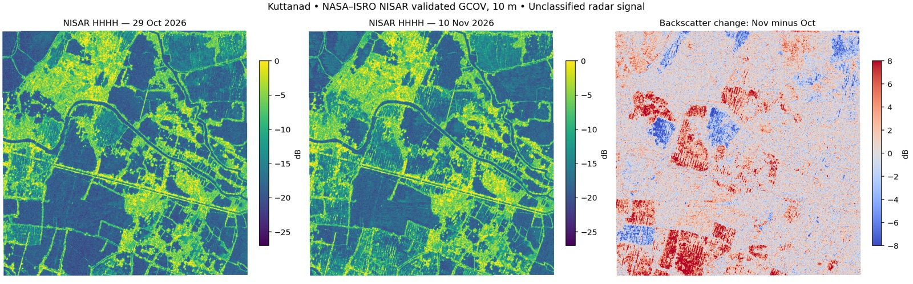

# Validated NISAR GCOV case study — Kuttanad (Kerala)

**Status: first real NISAR radar difference extracted and measured, November 14, 2026. Not yet an inundation classification.**

## Scene selection and provenance

- Study box: WGS84 `76.42,9.40,76.49,9.47` (lon/lat).
- Source: `NISAR_L2_GCOV_V1`, NASA Earthdata CMR `C3622241360-ASF`.
- Oct 29: `NISAR_L2_PR_GCOV_034_077_D_084_4005_DHDH_A_20261029T132026_20261029T132100_P05036_N_F_J_001`
- Nov 10: `NISAR_L2_PR_GCOV_035_077_D_084_4005_DHDH_A_20261110T132027_20261110T132100_P05036_N_F_J_001`
- Both matching `077_D_084_4005_DHDH`, P05036, validated production.
- NASA Harmony subset: `/science/LSAR/GCOV/grids/frequencyA/HHHH` variable, spatially clipped to the small AOI, exported as GeoTIFF. Harmony job IDs recorded in local research summary (no auth tokens).

## What was actually calculated

Both rasters are native **EPSG:32643, 10 m**, identical **776 × 771** shape, identical bounds. For pixels with positive finite backscatter in *both* scenes:

`HHHH_dB = 10 × log10(HHHH_gamma0_power)`

`delta_dB = Nov_10_dB − Oct_29_dB`

| Statistic | Actual observed value |
|---|---:|
| Valid common pixels | 594,958 |
| Valid common area | 59.4958 km² |
| Oct 29 median backscatter | -15.1419 dB |
| Nov 10 median backscatter | -13.803 dB |
| Paired median delta | +0.6231 dB |
| Paired mean delta | +0.7921 dB |
| Delta below −3 dB | 14.02% of common valid pixels |
| Delta above +3 dB | 24.50% of common valid pixels |

[Machine-readable analysis](nisar_pair_summary.json). Reproduce with [Harmony download script](../../scripts/harmony_validated_kuttanad.py) and [radar analysis script](../../scripts/analyze_harmony_kuttanad.py).

## What the evidence does NOT prove

These changes can arise from **water extent, agricultural fields, vegetation, roughness, soil moisture, look geometry, or processing artifacts**. Neither a dark pixel nor a >3 dB change alone proves flooding. The difference map uses no water classifier, quality/confidence validation, OPERA comparison for these dates, or ground-truth test. Do not cite the dB-change fractions as flood-area percentages.

## Next step

Assess candidate water-change interpretations against independent products, with explicit date offset and quality masks. OPERA DSWx-HLS around Oct 29 and OPERA DSWx-S1 Oct 21/Nov 2 are **potential evidence**, not a validated reference pair spanning Oct 29/Nov 10. If the agreement is poor, reconsider the case or method.

Local TIFFs remain off GitHub to avoid committing imagery and large source files. The September OPERA-only experiment is a separate study: `../kuttanad_2026_09/`.
