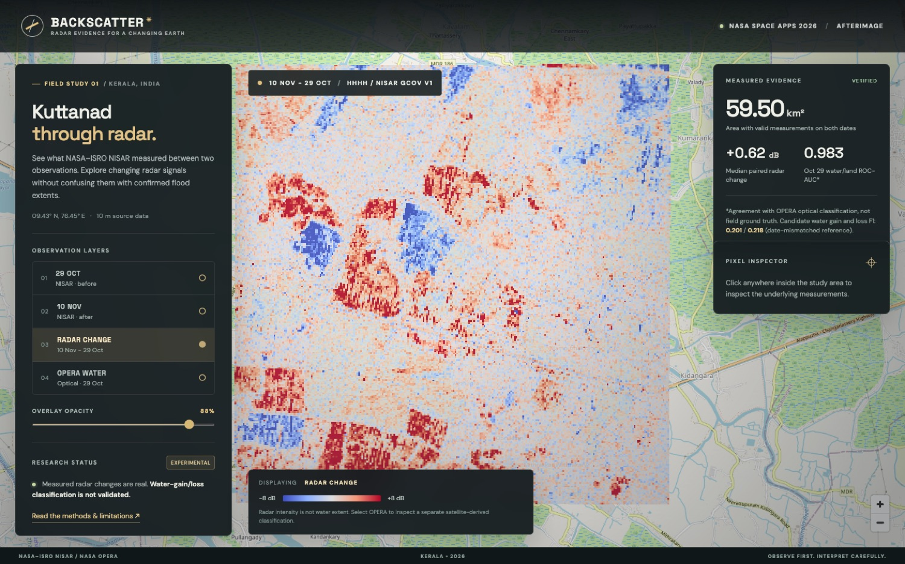
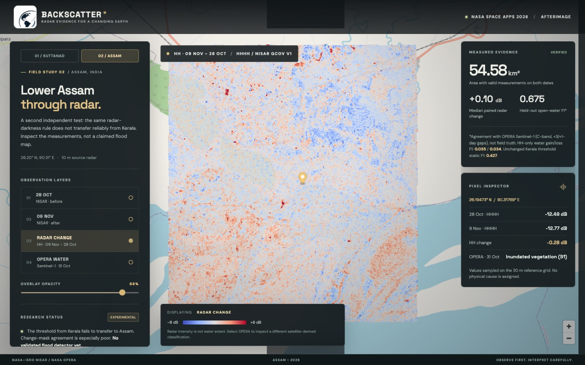
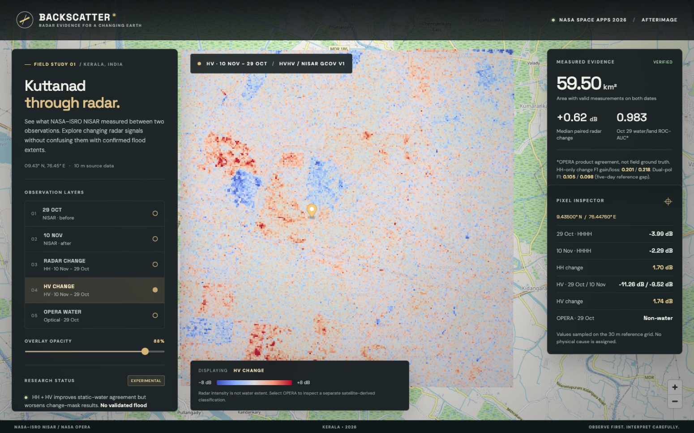
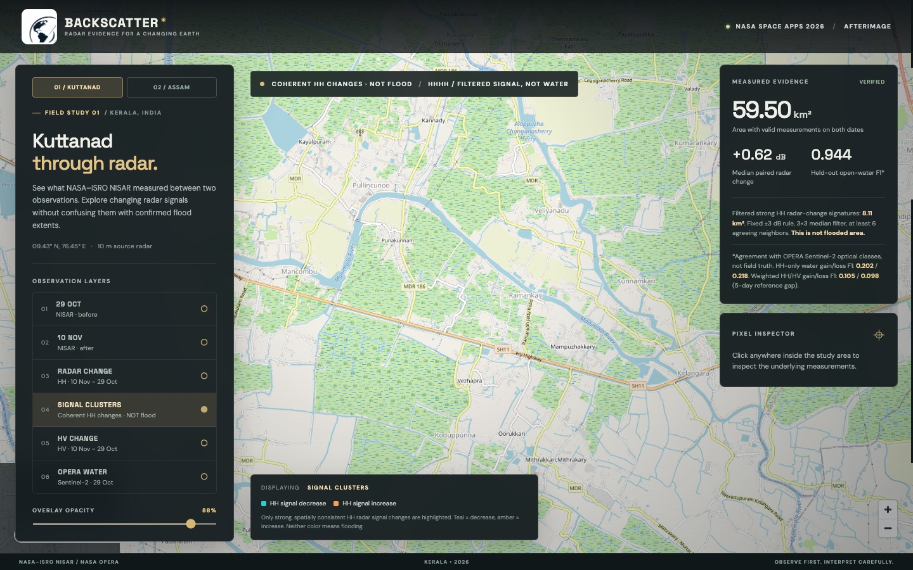

# Backscatter interactive demo



A static React/Vite/MapLibre map displaying **real NASA–ISRO NISAR validated GCOV** measurements from Kuttanad, Kerala.

## Run

```bash
cd web
npm install
npm run dev
```

Visit the local address printed by Vite. No Earthdata token is needed to view the curated, already-prepared sample.

## Two actual geographic studies

After starting the web server:

- Kuttanad, Kerala: http://127.0.0.1:5173/?study=kuttanad — NISAR Oct 29/Nov 10, HH/HV radar, OPERA DSWx-HLS Sentinel-2 optical October 29.
- Lower Assam, India: http://127.0.0.1:5173/?study=assam — NISAR Oct 28/Nov 09, HHHH radar and OPERA DSWx-S1 Sentinel-1 WTR October 31. The second reference is November 10 (+3/+1 calendar days relative to NISAR).

Use the 01 KUTTANAD / 02 ASSAM switch inside the app. Both use **real satellite raster measurements**, not manually painted maps. Assam has four layers (before, after, HHHH change, and OPERA S1); Kuttanad has a fifth HVHV radar-change layer. No HV measurements are invented for Assam.



### What the second case reveals

- Common valid 30 m NISAR area: 54.576 km2; median paired HH backscatter signal +0.1012 dB.
- Threshold fitted in Assam to reference OPERA class 0/1 (west half) gives held-out static F1 0.6755, but gain/loss F1 only 0.0353/0.0336.
- An unchanged Kerala-trained -10.75 dB cutoff gives Assam static F1 0.4275 and gain/loss F1 0/0.
- OPERA S1 class 3 means **inundated vegetation**, not HLS partial-water class 2.
- These are agreements with satellite-derived references, not field-confirmed flood extent. Different reference products and offsets prevent treating F1 across regions as a controlled accuracy comparison.

[Full measured report](../research/assam_validated_2026_10_11/MEASURED_RESULTS.md) · [Actual metrics](../research/assam_validated_2026_10_11/assam_nisar_opera_diagnostic.json)

## What it shows

- NISAR 2026-10-29 HHHH backscatter.
- NISAR 2026-11-10 HHHH backscatter.
- Measured **HHHH and HVHV** radar-change overlays, *not* inferred flooding.
- Pixel inspector reports HH and HV values on each date plus both measured changes.
- The HVVV/HVVH off-diagonal products are **not** claimed; our additional layer is the measured **HVHV** diagonal covariance power.
- Independent OPERA DSWx-HLS 2026-10-29 optical water classifications.
- A click-to-inspect panel with 30-metre pixel measurements and satellite reference class.
- Quantified agreement with OPERA, including low change-detection F1 values.

The base map requires an internet connection (OpenStreetMap tiles); overlay rasters and pixel measurements are stored locally under `web/public/data`.

## Regenerate source assets

On a machine with the locally downloaded NISAR/OPERA GeoTIFFs from [the research pipeline](../docs/VALIDATED_DATA_EXECUTION.md):

```bash
python scripts/export_demo_assets.py
python scripts/export_assam_demo.py   # after authenticated NISAR / OPERA Assam TIFFs exist
python scripts/evaluate_signal_coherence.py  # rebuild coherent-signal overlays AND metadata
python scripts/check_web_assets.py            # verify all source-derived study assets
```

This generates small RGBA PNG layers and a little-endian binary 30-metre measurement grid. It does **not** export large source HDF5/GeoTIFFs or user tokens.

## Science limits

The application is a **radar evidence viewer**, not a validated flood detection tool. A static single-threshold water classifier achieved strong product-to-product agreement (east-half F1 0.9435), but change-mask agreement with temporally offset OPERA was weak (F1 0.2013 gain / 0.2181 loss). Those figures are not flood accuracy or field-ground-truth metrics. Read [the detailed research](../research/kuttanad_validated_2026_10_11/INDEPENDENT_COMPARISON.md).

## Dual-polarization experiment

The new cross-polarized **HVHV** layer, subswath mask and number-of-looks grids come from **real validated NISAR data**; all six research subsets were downloaded through Harmony. A fixed simple weighted HH+HV score improved static OPERA water/non-water agreement (east-half F1 0.9435 to 0.9533) while **reducing** water-gain/loss F1 (0.2022/0.2185 to 0.1053/0.0981). The viewer therefore **does not display the candidate change classifier as confirmed flooding**.

See [dual-polarization experiments](../research/kuttanad_validated_2026_10_11/DUAL_POLARIZATION.md).




## Original Backscatter logo

The header contains the original globe-and-radar mark selected for Backscatter in our September 2026 team logo review; the actual unmodified 1254 × 1254 source PNG is stored at `public/brand/backscatter-original.png`. The smaller mark and favicon are faithful crops of that user-provided original, not generated replacements. Click the header logo to view the complete artwork.


## Production-build test

The application uses **MapLibre GL JS v6**. Its ES module worker must be bundled explicitly with Vite's worker&url import and setWorkerUrl; otherwise production maps can appear blank even when pages load.

Build and test:

    cd web
    npm install
    npm run build
    npm run preview

The original Backscatter PNG, derived mark and favicon are all available at public/brand/. The raster image overlays and 30 m measurement grids are served from public/data/ for Kerala and public/data/assam/ for Assam. The web demo requires no Earthdata bearer token or external analysis service.




[Lower Assam signal-cluster screenshot](preview-signal-assam.jpg)

## New: coherent radar signal highlights

Both geographic studies now offer a **SIGNAL CLUSTERS** layer, identifying strong, spatially consistent **HHHH radar signal changes**, not floodwater:

- Median-filter each date on the aligned OPERA 30 m grid using a 3×3 window (at least 5 valid neighboring cells).
- Highlight cells changing by **at least 3 dB** whose 3×3 neighborhood has at least **6 cells with the same strong direction** and at least 7 valid cells.
- Teal means radar signal decreased; amber means it increased. **Neither means flooding.**
- This no-training method never reads OPERA WTR labels to produce the colored overlay. OPERA is used separately to evaluate its limitations.

Kuttanad has **8.11 km²** of strong coherent radar signal regions, and Lower Assam **0.43 km²**. These areas are **not water extent** and are not claims about an actual flood.

In Kuttanad the spatially coherent filter reduced the fraction of OPERA-classified stable non-water pixels flagged by ≈93% versus raw ±3 dB thresholding, but it missed additional true water-class changes. **In Assam it captured zero strict open-water transitions**, demonstrating that denoising cannot make the method universally reliable.

[Full reproducible research](../research/signal_coherence/README.md) · [Kerala metrics](../research/signal_coherence/kuttanad_metrics.json) · [Assam metrics](../research/signal_coherence/assam_metrics.json).
